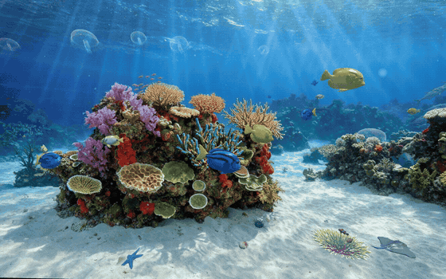
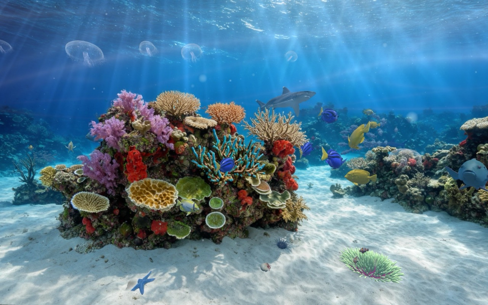

# Reef aquarium

A living coral reef in 3D for a spare screen. Tangs, angelfish, clownfish in their anemone, schools of anthias and
chromis, a pufferfish that sometimes blows up when a shark comes close, reef sharks and a hammerhead (now and then one takes a
straggler), rays that settle half-buried in the sand, a turtle, a moray that peeks from its hole and ambushes passing fish,
crabs and shrimp on the bottom, jellyfish pulsing through, and now and then a whale shark passing in the deep. Every
animal moves at its own pace with its own kind of swimming, finds its way round the coral, and the light follows the
time of day, from bright noon to a dark blue night, under a moving surface with caustics on the sand.

It's a web page drawing live 3D (three.js), not a video: it never repeats.





**Live demo:** https://cvcwebsolutions.github.io/reef-aquarium/ (needs a browser with WebGL 2; best full screen)

## Run it

No build step and no internet needed: the library, models and scene are all in this folder. Browsers don't load
ES modules from `file://`, so serve the folder with any static web server:

```sh
python3 -m http.server 8000
# open http://localhost:8000/
```

URL options: `?hour=21` (time of day instead of your clock), `?px=1` (render pixel ratio; lower is lighter on the GPU,
default 1.5), `?fps=1` (frame-rate readout), `?t=600` (start ten minutes into the simulation), `?size=true` (animals at
their real sizes; `today` draws them larger, the default `half` sits between), `?visit=turtle,whaleshark` (bring the rare
visitors in at once), `?hunt=60` (a shark hunt every 60 s instead of every few minutes).

`tools/view.html?m=bluetang,clownfish` shows models side by side from three angles.

## As an always-on screen

Any browser in full-screen or kiosk mode works, for example
`chromium --kiosk --noerrdialogs --disable-session-crashed-bubble http://localhost:8000/`. It was made for a 10" 1280x800
screen and holds 30-60 fps on a small Apple-silicon desktop; on a weaker GPU try `?px=1`.

## How it's made

- The reef itself is a single generated photograph made 2.5D with a depth estimate, so animals pass behind coral heads
  and settle into the sand.
- The animals are 3D models generated from reference photos we made, then simplified and compressed (meshopt, WebP).
  Their bodies bend in the vertex shader with a travelling wave; stiff-bodied fish beat only the tail and row with their
  fins.
- Jellyfish, the anemone, light shafts, caustics, marine snow and plankton are drawn by shader code.

Where every file comes from and on what terms: [SOURCES.md](SOURCES.md).

## Licence

MIT, © 2026 CVC Web Solutions. See [LICENSE](LICENSE) and, for the bundled three.js, `vendor/LICENSE-three.txt`.
The images and models are AI-generated; see [SOURCES.md](SOURCES.md).
